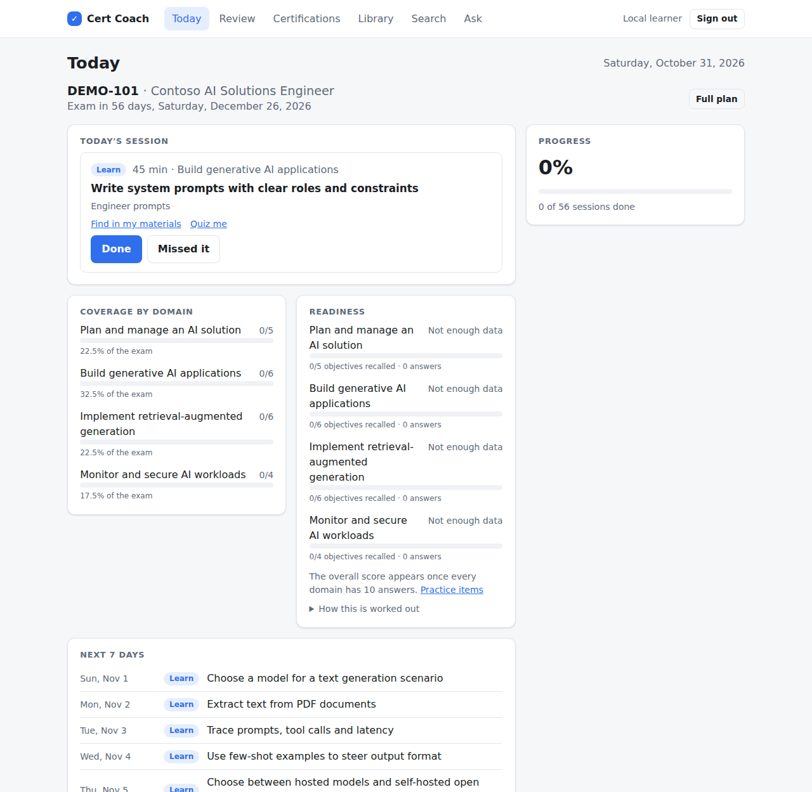
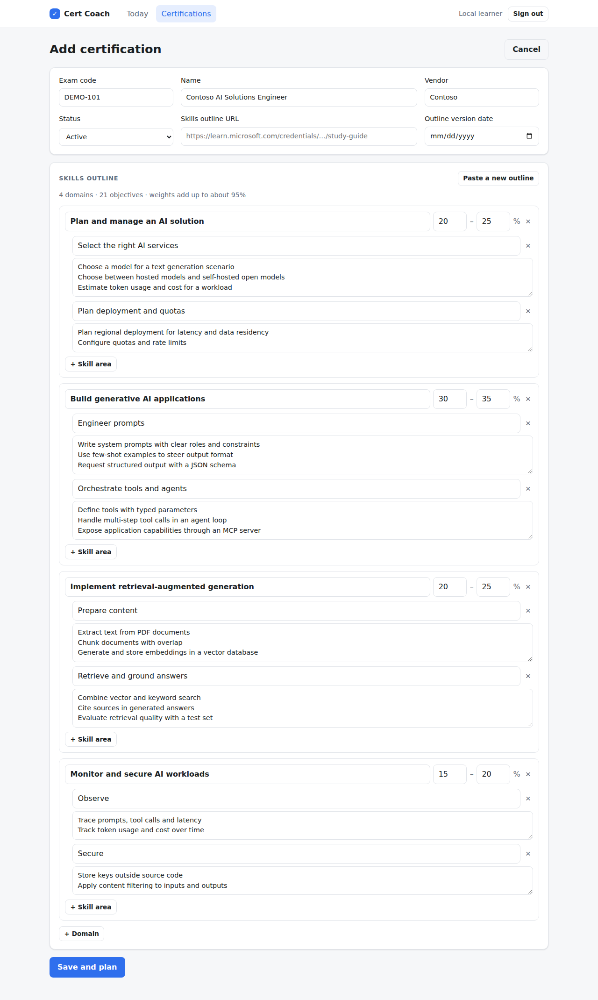
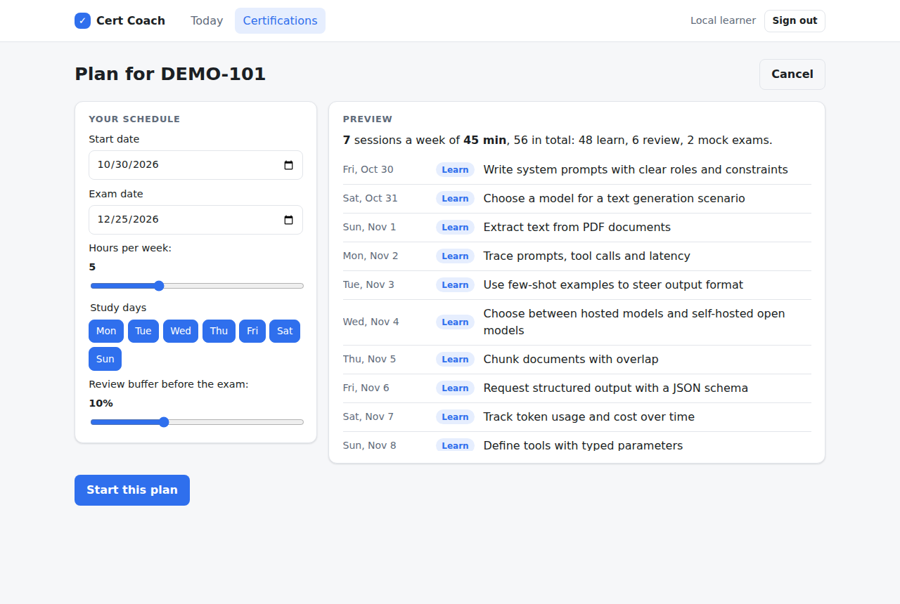
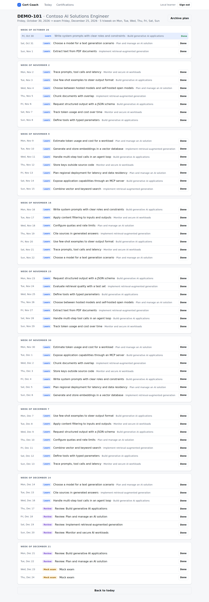
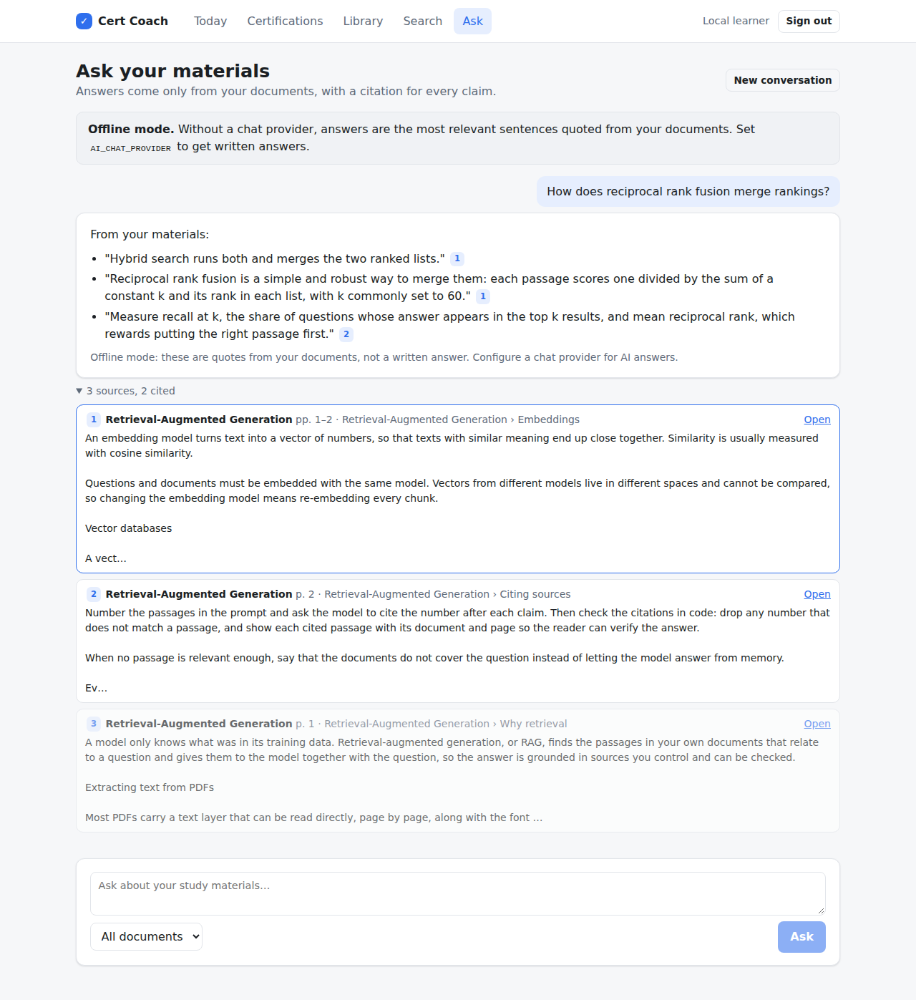
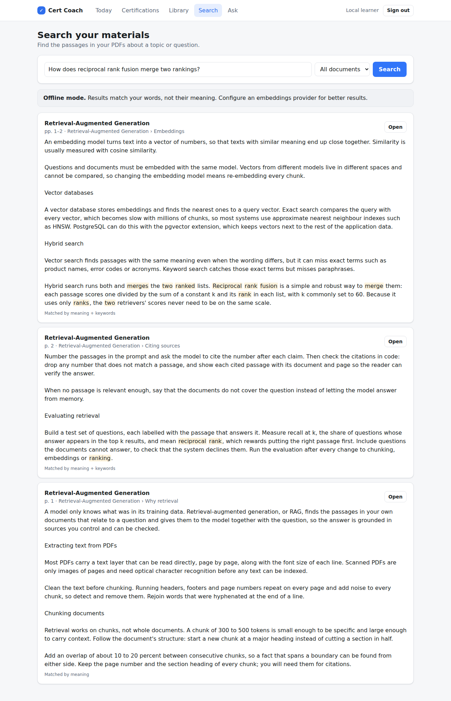
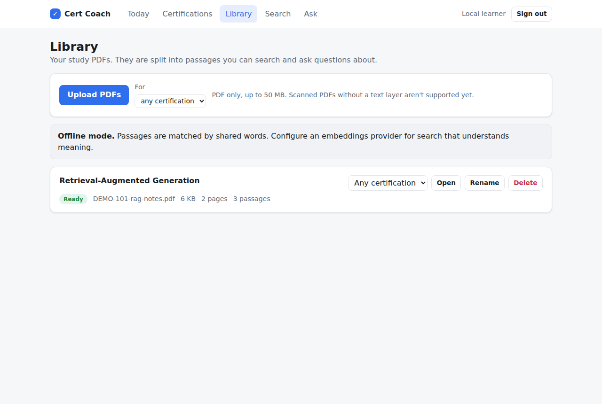
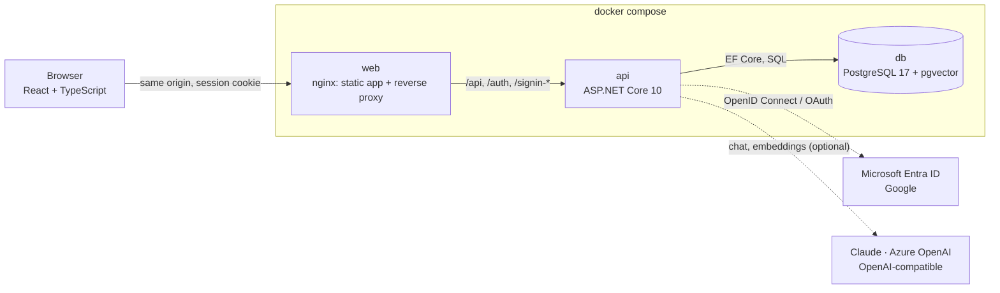
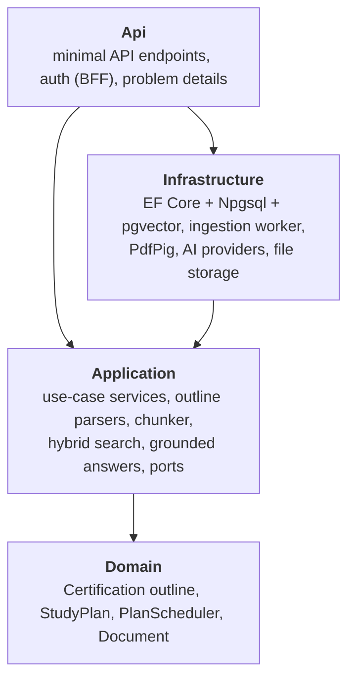
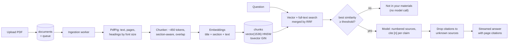

# Cert Coach

[](https://github.com/gn02ash/cert-coach/actions/workflows/ci.yml)

A personal certification study assistant. Paste an exam's official skills outline, set your exam date and weekly hours, and get a plan of short daily sessions weighted by how much each domain counts on the exam. Miss a day and the plan reschedules itself; run out of time and it tells you exactly how many hours, or how many extra days, you need.

Upload your study PDFs and ask questions about them. Answers come only from your documents, with a citation to the page for every claim, and when your documents don't cover a question it says so instead of guessing.



<details>
<summary>More screenshots</summary>

| Paste and edit an outline | Preview a plan |
|---|---|
|  |  |



| Ask your documents, with citations | Search them |
|---|---|
|  |  |



The screenshots are taken by the end-to-end test in CI against `docker compose up`, in offline mode, so Ask shows quoted sentences rather than a written answer.

</details>

## Features

**Phase 1: study plan**

- **Outline import.** Paste a Microsoft Learn study guide (or any outline with weighted domains). A parser turns it into domains, skill areas and objectives that you can edit before saving.
- **Weighted daily plan.** 30–45 minute sessions on the days you choose. Every objective gets at least one session; extra time goes to heavier domains; domains are interleaved, and a review buffer plus mock exams sit before the exam.
- **Automatic rescheduling.** Mark a session missed, or simply skip a few days, and outstanding work moves to the remaining days. The review buffer absorbs it first. If it no longer fits, the plan packs objectives together and suggests more hours per week or a later exam date.
- **Dashboard.** Today's session with its objectives, the next 7 days, progress, and coverage per exam domain.
- **Retired exams flagged.** Certifications carry a status (Active, Beta, Retired, Replaced by X).
- **Sign-in** with Microsoft Entra ID or Google, or a one-click local login.

**Phase 2: your documents** (this release)

- **Library.** Upload PDFs (optionally for one certification). They are processed in the background: text extracted with headings detected from font size, split into passages that follow the document's structure, and embedded.
- **Search.** Hybrid search: meaning (pgvector) and keywords (PostgreSQL full-text) merged with reciprocal rank fusion. Each session on the dashboard has **Find in my materials**.
- **Ask.** Streamed answers grounded in your passages, with a citation chip per claim that opens the PDF at the cited page. Questions your documents don't cover are declined without calling a model.
- **Any provider.** Claude (default `claude-opus-5-5`), Azure OpenAI or any OpenAI-compatible server for answers; Azure OpenAI or OpenAI-compatible embeddings. With no keys, an offline mode keeps everything working: word-matching search and quoted answers.
- **Parse with AI.** Outlines in layouts the parser can't read, such as tables copied from a PDF, can be parsed by the chat model into the same editable draft.
- **Retrieval evaluation.** A synthetic test set and tool that score recall@k, MRR and the "not in your materials" gate. CI fails if retrieval quality drops. See [`eval/`](eval/README.md).

**Roadmap**

- [x] Phase 2: upload your PDFs, RAG answers with page citations, and a retrieval evaluation set
- [ ] Phase 3: generated practice questions and flashcards, SM-2 spaced repetition, readiness score per domain
- [ ] Phase 4: certification recommendations from your CV
- [ ] Phase 5: Microsoft Learn and YouTube resources per objective, and an MCP server (`get_today_session`, `quiz_me`, …)

## Run it

You need [Docker](https://docs.docker.com/get-docker/). Then:

```bash
docker compose up --build
```

Open <http://localhost:8080>, choose **Local dev login**, go to **Certifications → Add certification** and click **Use the sample outline**. To try Search and Ask, upload [`samples/DEMO-101-rag-notes.pdf`](samples/DEMO-101-rag-notes.pdf) in **Library**.

Everything works without configuration, in offline mode. For AI answers and semantic search, copy [`.env.example`](.env.example) to `.env` and set the `AI_*` variables, for example:

```bash
AI_CHAT_PROVIDER=Anthropic
AI_CHAT_API_KEY=<your Anthropic key>
AI_EMBEDDINGS_PROVIDER=AzureOpenAI
AI_EMBEDDINGS_ENDPOINT=https://<resource>.openai.azure.com
AI_EMBEDDINGS_MODEL=text-embedding-3-small
AI_EMBEDDINGS_API_KEY=<your Azure OpenAI key>
```

The same file sets ports, the database password and sign-in providers. Existing documents are re-embedded automatically when the embedding model changes.

## Architecture



The backend follows a layered, clean architecture. Dependencies point inward, and the scheduling rules live in a domain layer with no I/O at all:



```text
src/
  CertCoach.Domain/          entities and pure logic: outline, StudyPlan aggregate, PlanScheduler, Document
  CertCoach.Application/     services, outline parsers, chunker, hybrid search + RRF, Ask, ports
  CertCoach.Infrastructure/  DbContext, mappings, migrations, PDF extraction, ingestion worker, AI providers
  CertCoach.Api/             endpoints (incl. server-sent events), sign-in, errors; emits openapi.json at build time
tests/
  CertCoach.Domain.Tests/          scheduler, rescheduling, document lifecycle (unit)
  CertCoach.Application.Tests/     outline parsers, chunker, rank fusion, prompts and citations (unit)
  CertCoach.Infrastructure.Tests/  PDF extraction, AI setup; mappings and migrations against real PostgreSQL
  CertCoach.Api.IntegrationTests/  the HTTP API end to end against real PostgreSQL, ingestion worker included
tools/
  CertCoach.Eval/            retrieval evaluation (recall@k, MRR, decline gate) over eval/
web/                         React app; TypeScript types generated from the API's OpenAPI document
  e2e/                       Playwright test that drives the Docker Compose stack in CI
docker/                      Dockerfiles and nginx config
samples/                     synthetic sample outline and PDF (not a real exam)
eval/                        synthetic corpus and labelled questions for the retrieval evaluation
```

## How the plan is built

1. **Cadence.** Hours per week and study days become a session length between 30 and 45 minutes. There is one session per study day, plus a second only when the hours can't fit otherwise (at most two 45-minute sessions a day). Sessions are spread evenly across the week.
2. **Priorities when time is short.** Every objective first gets a Learn session, then come mock exams (one or two), then the review buffer (10% of sessions by default).
3. **Weighting.** Remaining Learn sessions are split across domains in proportion to the midpoint of each domain's published weight range. A largest-deficit allocation keeps the total exact.
4. **Interleaving.** A smooth weighted round-robin orders the sessions, so a 35% domain comes up about twice as often as a 15% one throughout the plan instead of in one block.
5. **Rescheduling.** Missed Learn content moves to the front of the queue; everything planned from today on is laid out again. Completed history is never rewritten.

The scheduler is a pure, deterministic function: the same inputs always give the same plan, which makes it straightforward to test (see `PlanSchedulerGenerateTests` and `StudyPlanTests`).

## How questions are answered



1. **Ingestion.** An upload is stored and queued. The worker claims it with `FOR UPDATE SKIP LOCKED`, extracts the text layer, drops running headers and page numbers, and treats lines set larger than the body text as headings.
2. **Chunking.** About 450 tokens per chunk (cl100k). A top-level heading always starts a new chunk, smaller headings do once a chunk is half full, and the last sentences repeat at the start of the next chunk. Each chunk keeps its page range and section path.
3. **Retrieval.** The question is embedded and searched two ways in one database: cosine distance on an HNSW index, and full-text search that matches any of the question's words. Reciprocal rank fusion merges the two rankings by rank alone, so their scores never need a common scale.
4. **Answering.** If even the best passage is not similar enough, the answer is "not in your materials" and no model is called. Otherwise the model gets a fixed system prompt (cacheable) and the passages as numbered `<source>` blocks it is told to treat as data. The answer streams as server-sent events. Citations to numbers that don't exist are dropped, and every cited source links to the PDF page.

## Design decisions

| Decision | Why |
|---|---|
| **Clean architecture, but no repository layer** | EF Core's `DbSet` already is a repository and unit of work. Services depend on a small `ICertCoachDbContext` port instead of a generic wrapper. |
| **Plain services, no MediatR** | Fewer moving parts for a small domain, and no commercially licensed dependency. |
| **Aggregates own their collections** | EF maps navigations to private fields, so sessions can only change through `StudyPlan` methods that keep the plan consistent. |
| **Client-generated UUIDv7 keys** | IDs exist before saving, so the scheduler can produce complete sessions in memory. They are marked `ValueGeneratedNever` so EF inserts rescheduled sessions instead of updating them. |
| **Session objectives as `uuid[]`** | They are only read with their session, and a plan is regenerated rather than patched when an outline changes. The outline is locked while a plan is active, which keeps those IDs valid. |
| **Backend-for-frontend authentication** | The API runs the OIDC/OAuth flows; the browser only holds an `HttpOnly`, `SameSite=Lax` cookie, never a token. State-changing calls also need an `X-CSRF` header. |
| **Users matched by provider subject, never email** | Linking accounts on an unverified email claim is a known account-takeover risk. |
| **"Today" uses the learner's time zone** | Kept in sync from the browser, so a session doesn't flip days at midnight UTC. |
| **Generated API types** | The API writes `openapi.json` at build time and the web app generates TypeScript types from it. CI fails if either is stale. |
| **Real PostgreSQL in tests** | Testcontainers runs the real migrations against `pgvector/pgvector:pg17`, so tests check SQL behavior, not an in-memory approximation. |
| **pgvector from the first migration** | The Phase 2 chunk tables needed no extension change, and vectors live next to the rest of the data in one backup. |
| **Deterministic outline parser first, AI parsing as an option** | The parser works offline with no keys. "Parse with AI" appears only when a chat provider is configured, and its draft passes the same checks and lands in the same editor for review. |
| **Decline before calling a model** | When the best passage isn't similar enough to the question, Ask answers "not in your materials" itself. That saves a call, and it removes the main source of made-up answers. |
| **Measured, not guessed** | The retrieval evaluation in CI caught that offline embeddings counted stop words, which made the decline gate useless. Removing them took declines from 1 of 6 to 3 of 6. |
| **`Microsoft.Extensions.AI` as the provider abstraction** | `IChatClient` and `IEmbeddingGenerator` are the standard .NET interfaces, and Anthropic and OpenAI ship adapters for them, so there is no hand-written provider layer to maintain. |
| **One OpenAI SDK for Azure and OpenAI-compatible servers** | Azure OpenAI's v1 API speaks the OpenAI protocol, so Azure, OpenAI, Ollama and LM Studio share one code path. |
| **Offline mode by default** | Embeddings fall back to a word-hashing model and answers to quoted passages, so the app, CI and the e2e test run without any API key. |
| **The documents table is the ingestion queue** | A background worker claims the next document with `FOR UPDATE SKIP LOCKED`. Jobs survive restarts, a stalled claim is taken over after 10 minutes, and there is no broker to run. |
| **Structure-aware chunks with citations built in** | Chunks follow the PDF's headings (detected from font size) and keep their page range and section path, so every answer can cite "p. 12 · Retrieval › Hybrid search". |
| **Full-text search generated by PostgreSQL** | A stored `tsvector` column with a GIN index sits next to the `vector(1536)` column with an HNSW index, ready for hybrid search without keeping two stores in sync. |
| **Claude with server-side refusal fallback** | Requests opt into the API's default fallback model, so a policy decline is re-served instead of failing the answer. |

## Configuration

All settings are environment variables (`.env` for Docker Compose). No secrets are stored in the repository.

| Variable | Default | Purpose |
|---|---|---|
| `WEB_PORT` | `8080` | Port the app is served on |
| `POSTGRES_PASSWORD` | `certcoach-local` | Database password. The database is only reachable from this machine. |
| `AUTH_DEV_LOGIN` | `true` | One-click local sign-in. **Turn off if the app is reachable by anyone else.** |
| `MICROSOFT_CLIENT_ID`, `MICROSOFT_CLIENT_SECRET` | empty | Enables "Sign in with Microsoft" |
| `MICROSOFT_TENANT_ID` | `common` | `common` accepts work, school and personal accounts |
| `GOOGLE_CLIENT_ID`, `GOOGLE_CLIENT_SECRET` | empty | Enables "Sign in with Google" |
| `AI_CHAT_PROVIDER` | `Offline` | Who answers questions: `Anthropic`, `AzureOpenAI`, `OpenAICompatible` or `Offline` |
| `AI_CHAT_MODEL`, `AI_CHAT_API_KEY`, `AI_CHAT_ENDPOINT` | empty | Model (Anthropic defaults to `claude-opus-5-5`; for Azure, the deployment name), key, and endpoint for Azure or OpenAI-compatible servers |
| `AI_EMBEDDINGS_PROVIDER` | `Offline` | Who embeds your documents: `AzureOpenAI`, `OpenAICompatible` or `Offline` |
| `AI_EMBEDDINGS_MODEL`, `AI_EMBEDDINGS_API_KEY`, `AI_EMBEDDINGS_ENDPOINT` | empty | Deployment name (for example `text-embedding-3-small`), key and endpoint. Vectors are stored at 1536 dimensions. |

The API checks these settings at startup and lists every missing one by name. `GET /api/ai/status` shows which providers are active.

### Sign in with Microsoft (Entra ID)

1. In the [Entra admin center](https://entra.microsoft.com), open **App registrations → New registration**.
2. Supported account types: *Accounts in any organizational directory and personal Microsoft accounts*.
3. Redirect URI: **Web**, `http://localhost:8080/signin-oidc`.
4. Under **Certificates & secrets**, create a client secret.
5. Put the application (client) ID and the secret in `.env` as `MICROSOFT_CLIENT_ID` and `MICROSOFT_CLIENT_SECRET`.

### Sign in with Google

1. In the [Google Cloud console](https://console.cloud.google.com/apis/credentials), create an **OAuth client ID** of type *Web application*.
2. Authorized redirect URI: `http://localhost:8080/signin-google`.
3. Put the client ID and secret in `.env` as `GOOGLE_CLIENT_ID` and `GOOGLE_CLIENT_SECRET`.

## Development

Prerequisites: .NET 10 SDK, Node 24, Docker.

Start only the database:

```bash
docker compose up db -d
```

Run the API on <http://localhost:5265>. It applies migrations and enables the dev login in Development:

```bash
dotnet run --project src/CertCoach.Api
```

Run the web app on <http://localhost:5173>, which proxies to the API:

```bash
cd web && npm install && npm run dev
```

### Tests

Run every backend test. The Infrastructure and Api suites need Docker running:

```bash
dotnet test
```

Run the web unit and component tests:

```bash
cd web && npm test
```

Run the retrieval evaluation (starts its own database container; see [`eval/README.md`](eval/README.md)):

```bash
dotnet run --project tools/CertCoach.Eval
```

Run the browser end-to-end test against `docker compose up`:

```bash
cd web && npx playwright test
```

After changing an endpoint, `dotnet build` refreshes `web/src/api/openapi.json`. Then regenerate the TypeScript types:

```bash
cd web && npm run gen:api
```

CI runs the backend tests, the web checks, the retrieval evaluation (failing below its quality floor), and the end-to-end test against the real Docker Compose stack on every pull request.

## License

[MIT](LICENSE)
